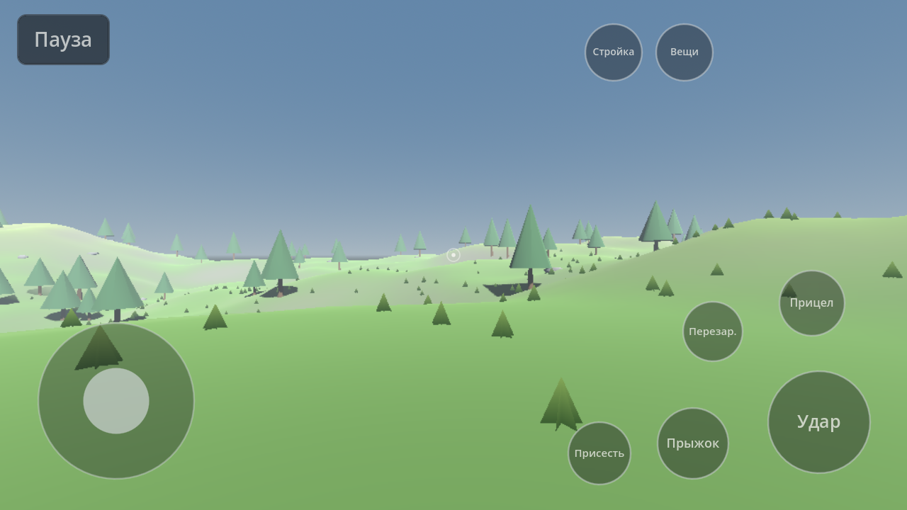

# Пустой Берег (Empty Shore)

Мобильная многопользовательская игра о хардкорном выживании и строительстве баз для Android.
Рабочее название: **«Пустой Берег»** (англ. *Empty Shore*), идентификатор пакета `com.emptyshore.game`.

Правила проекта — в [`AGENTS.md`](AGENTS.md) (копия в `CLAUDE.md`), план по этапам — в [`docs/ROADMAP.md`](docs/ROADMAP.md).

Текущее состояние: **этап 0 «Каркас»** — проект, управление под телефон, тестовый ландшафт, меню, настройки, отладочная панель, CI и экспорт Android.



## Технологии и версии

| Что | Версия | Откуда взято |
|-----|--------|--------------|
| Godot | **4.7.2-stable** (последняя стабильная 4.x на момент начала этапа 0) | GitHub Releases API `godotengine/godot` |
| Язык | GDScript со статической типизацией | — |
| Рендер | Compatibility (OpenGL ES 3 / OpenGL 3.3) для ПК и телефонов | `project.godot` |
| Физика | Jolt Physics (встроена в Godot) | `project.godot` |
| Тесты | GUT 9.7.1 (MIT), поддерживает Godot 4.7 | `addons/gut` |
| Android ABI | arm64-v8a | `export_presets.cfg` |
| Android minSdk | **24** (Android 7.0) — минимум для Godot 4.7.2 (`DEFAULT_MIN_SDK_VERSION`) | исходники Godot 4.7.2 |
| Android targetSdk | **36** (Android 16) — требование Google Play для новых приложений и обновлений с 31.08.2026 | developer.android.com «Target API level requirement» |
| JDK для экспорта | 17 | документация Godot 4.7 |
| Android SDK для Gradle-сборки (AAB) | platforms;android-36, build-tools;36.1.0, ndk;29.0.14206865 | `platform/android/java/app/config.gradle` Godot 4.7.2 |

Лимиты размера Google Play (проверено по справке Play Console): базовый модуль AAB — до 500 МБ в сжатом виде,
пакет ресурсов (asset pack) — до 1,5 ГБ, все install-time модули вместе — до 4 ГБ. Если игра перерастёт базовый модуль, используем Play Asset Delivery.

## Структура

```
scenes/        сцены (main — меню и игра, player — персонаж)
scripts/
  core/        сервисы autoload (Events, Settings, SaveGame), настройки, сохранения, автокачество
  player/      персонаж, распознавание двойного толчка стика
  world/       тестовый ландшафт и его математика
  ui/          HUD, сенсорное управление, меню, настройки, отладочная панель
  building/ items/ net/   заготовки под этапы 1–4
data/
  balance/     параметры (качество, персонаж, ландшафт) в JSON
  i18n/        строки интерфейса (CSV: keys,ru)
  items/ recipes/ loot/   заготовки под этап 1
assets/        тема интерфейса, иконка; модели/текстуры/звук — с этапа 1
tests/unit/    тесты GUT
tools/         скрипты командной строки (импорт, тесты, экспорт, снимки)
docs/          ROADMAP, PERFORMANCE, NETWORK, IDEAS, снимки экрана
```

Логика без сцен (можно тестировать и запускать на сервере): `GameSettings`, `AutoQualityMonitor`,
`SaveFile`/`SaveMigrator`, `TerrainMath`, `StickMath`, `DoubleTapDetector`, `UiMetrics`.

## Как запустить

Нужен Godot 4.7.2 (обычная сборка, не .NET).

```bash
# Открыть в редакторе
godot --editor --path .

# Запустить игру с ПК (WASD, мышь, Пробел, C, E, R, Tab, B, Q — автобег, Esc — пауза, F3 — отладка)
godot --path .

# Импорт, тесты и дымовой запуск без окна (путь к Godot можно задать переменной GODOT)
GODOT=/path/to/godot tools/import.sh
GODOT=/path/to/godot tools/run_tests.sh
GODOT=/path/to/godot tools/smoke_run.sh
```

Сенсорное управление на ПК можно включить в настройках («Сенсорное управление» → «Всегда»), но ввод пальцами
работает только на сенсорном экране.

## Как собрать APK / AAB

1. Установить JDK 17 и Android SDK (пакеты из таблицы выше), задать `JAVA_HOME` и `ANDROID_HOME`.
2. Скачать `Godot_v4.7.2-stable_export_templates.tpz` и распаковать папку `templates/` в
   `~/.local/share/godot/export_templates/4.7.2.stable/`.
3. Ключ подписи — только через переменные окружения (в репозиторий не кладём):
   ```bash
   export GODOT_ANDROID_KEYSTORE_DEBUG_PATH=~/keys/debug.keystore
   export GODOT_ANDROID_KEYSTORE_DEBUG_USER=androiddebugkey
   export GODOT_ANDROID_KEYSTORE_DEBUG_PASSWORD=android
   GODOT=/path/to/godot tools/export_android.sh apk debug      # build/android/empty-shore-debug.apk

   export GODOT_ANDROID_KEYSTORE_RELEASE_PATH=~/keys/release.jks
   export GODOT_ANDROID_KEYSTORE_RELEASE_USER=<alias>
   export GODOT_ANDROID_KEYSTORE_RELEASE_PASSWORD=<пароль>
   GODOT=/path/to/godot tools/export_android.sh aab release    # build/android/empty-shore-release.aab
   ```
   Debug-ключ создаётся так:
   `keytool -genkeypair -keystore debug.keystore -storepass android -alias androiddebugkey -keypass android -keyalg RSA -validity 10000 -dname "CN=Android Debug,O=Android,C=US"`
4. Установить на телефон: `adb install -r build/android/empty-shore-debug.apk`.

Пресеты экспорта: «Android APK» (без Gradle, minSdk/targetSdk из шаблона Godot = 24/36) и «Android AAB»
(Gradle-сборка, minSdk 24, targetSdk 36; шаблон ставится в `android/` автоматически, папка в `.gitignore`).

### CI (GitHub Actions)

`.github/workflows/ci.yml`: на каждый push и PR — импорт, тесты GUT и дымовой запуск сцен; на `main` и вручную —
debug APK (одноразовый debug-ключ создаётся в CI), а при наличии секретов `ANDROID_KEYSTORE_BASE64`,
`ANDROID_KEYSTORE_ALIAS`, `ANDROID_KEYSTORE_PASSWORD` — подписанные release APK и AAB. Сборки — в артефактах запуска.

## Принятые решения

**Формат файлов настроек и сохранений (этап 0).** Варианты:
1. *JSON-конверт с версией* (`{"format_version", "saved_at", "data"}`) — читается глазами, легко писать миграции и тесты, но больше по объёму и медленнее для больших миров.
2. *Двоичный формат Godot* (`var_to_bytes` / `FileAccess.store_var`) — компактнее и быстрее, но его не прочитать без игры, а изменения в типах данных ломают совместимость незаметнее.

Выбран **вариант 1** для настроек и небольших данных игрока. Для мира (чанки, постройки) на этапах 1–3 формат будет предложен отдельно — вероятно, двоичные файлы на чанк внутри того же конверта с версией.
Запись всегда идёт через временный файл и переименование; при повреждённом основном файле читается целый `.tmp`.

## Лицензии

См. [`CREDITS.md`](CREDITS.md) (сторонние компоненты) и [`docs/LICENSES.md`](docs/LICENSES.md) (заметки о лицензиях).
