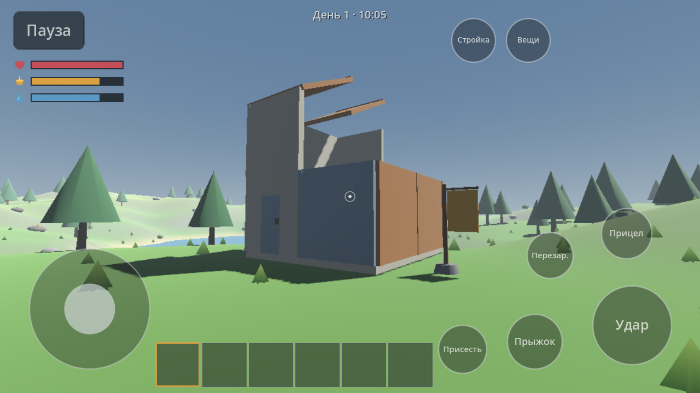
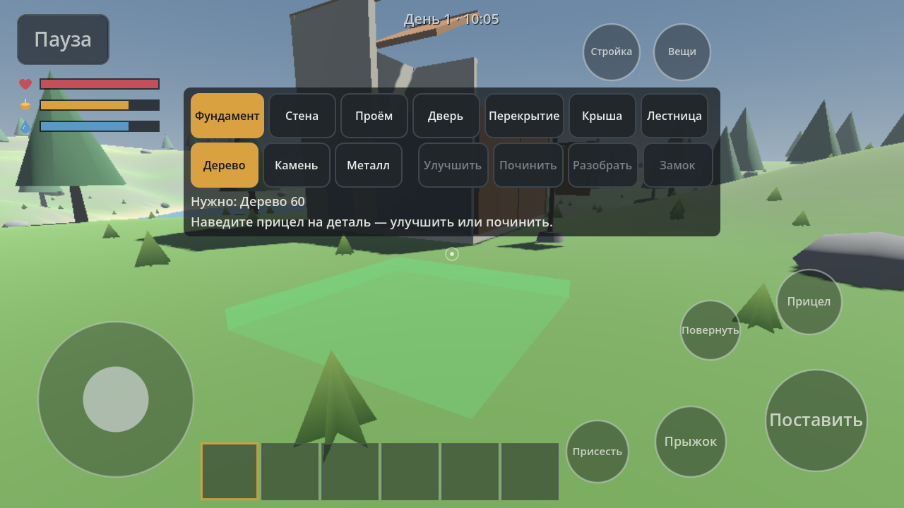
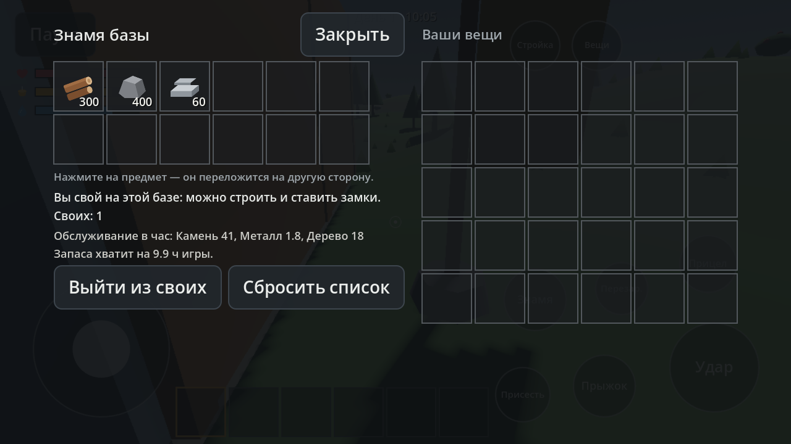

# Пустой Берег (Empty Shore)

Мобильная многопользовательская игра о хардкорном выживании и строительстве баз для Android.
Рабочее название: **«Пустой Берег»** (англ. *Empty Shore*), идентификатор пакета `com.emptyshore.game`.

Правила проекта — в [`AGENTS.md`](AGENTS.md) (копия в `CLAUDE.md`), план по этапам — в [`docs/ROADMAP.md`](docs/ROADMAP.md).

Текущее состояние: **этап 2 «Строительство»** (готов к приёмке) — постройки по сетке (фундамент, стена, проём,
дверь, перекрытие, крыша, лестница) из дерева, камня и металла с улучшением, ремонтом и разбором; двери с кодовым
замком; ящики; знамя базы (право строить, запас на обслуживание); износ построек без обслуживания; столкновения
с деревьями и камнями.
Этап 1 «Выживание» — ресурсы и добыча, инвентарь (6 + 24 + экипировка), крафт, здоровье/голод/жажда, день и ночь,
костёр, сохранение и «Продолжить». Этап 0 «Каркас» — проект, управление под телефон, меню, настройки, отладка, CI и экспорт Android.





## Технологии и версии

| Что | Версия | Откуда взято |
|-----|--------|--------------|
| Godot | **4.7.2-stable** (последняя стабильная 4.x на момент начала этапа 0) | GitHub Releases API `godotengine/godot` |
| Язык | GDScript со статической типизацией | — |
| Рендер | Compatibility (OpenGL ES 3 / OpenGL 3.3) для ПК и телефонов | `project.godot` |
| Физика | Jolt Physics (встроена в Godot) | `project.godot` |
| Тесты | GUT 9.7.1 (MIT), поддерживает Godot 4.7 | `addons/gut` |
| Android ABI | arm64-v8a | `export_presets.cfg` |
| Android minSdk | **24** (Android 7.0) — минимум для Godot 4.7.2 (`DEFAULT_MIN_SDK_VERSION`) | исходники Godot 4.7.2 |
| Android targetSdk | **36** (Android 16) — требование Google Play для новых приложений и обновлений с 31.08.2026 | developer.android.com «Target API level requirement» |
| JDK для экспорта | 17 | документация Godot 4.7 |
| Android SDK для Gradle-сборки (AAB) | platforms;android-36, build-tools;36.1.0, ndk;29.0.14206865 | `platform/android/java/app/config.gradle` Godot 4.7.2 |

Лимиты размера Google Play (проверено по справке Play Console): базовый модуль AAB — до 500 МБ в сжатом виде,
пакет ресурсов (asset pack) — до 1,5 ГБ, все install-time модули вместе — до 4 ГБ. Если игра перерастёт базовый модуль, используем Play Asset Delivery.

## Структура

```
scenes/        сцены (main — меню и игра, player — персонаж)
scripts/
  core/        сервисы autoload (Events, Settings, SaveGame), настройки, сохранения, автокачество
  player/      персонаж, распознавание двойного толчка стика
  world/       тестовый ландшафт и его математика
  ui/          HUD, сенсорное управление, быстрая панель, экран «Вещи» и крафт, меню, настройки, отладка
  items/       справочник предметов, инвентарь, крафт
  building/    постройки: данные деталей, сетка и опора, право владения и износ, отрисовка, призрак
  net/         заготовка под этап 4
data/
  balance/     параметры: качество, персонаж, ландшафт, выживание, день/ночь, ресурсные узлы, костёр/верстак, сессия
  items/       предметы (items.json)
  recipes/     рецепты (recipes.json)
  i18n/        строки интерфейса (CSV: keys,ru)
  loot/        заготовка под этап 3
assets/        тема интерфейса, иконки (приложение, предметы, показатели); моделей/текстур/звука извне нет
tests/unit/    тесты GUT
tools/         скрипты командной строки (импорт, тесты, экспорт, снимки)
docs/          ROADMAP, PERFORMANCE, NETWORK, IDEAS, снимки экрана
```

Логика без сцен (можно тестировать и запускать на сервере): `GameSettings`, `AutoQualityMonitor`,
`SaveFile`/`SaveMigrator`, `TerrainMath`, `StickMath`, `DoubleTapDetector`, `UiMetrics`, а с этапа 1 —
`ItemDB`, `Inventory`, `Crafting`, `SurvivalStats`, `DayNightCycle`, `ResourceField`, `Deployables` и объединяющая их
`SurvivalSession`, с этапа 2 — `BuildingDefs`, `BuildingGrid`, `BaseClaims`, `ItemStorage`.

## Как играть (этап 2: строительство)

- **Режим стройки:** кнопка «Стройка» (B). Сверху — панель: деталь (фундамент, стена, проём, дверь, перекрытие, крыша,
  лестница) и материал (дерево, камень, металл). Перед вами — «призрак» детали: зелёный — можно ставить, красный — нельзя
  (причина — в строке панели). Призрак сам встаёт в сетку 3 × 3 м там, куда вы смотрите: точный прицел не нужен.
  Справа: «Поставить» (бывшая «Удар») и «Повернуть» (бывшая «Перезар.», R) — сторона стены, направление лестницы и крыши,
  петли двери.
- **С чего начать дом:** фундаменты (соседний встаёт на ту же высоту) → стены и проём по краям → дверь в проём →
  перекрытие или крыша сверху (держится на стенах) → лестница на пол, если нужен второй этаж.
- **Деталь под прицелом:** «Улучшить» (дерево → камень → металл; дверь — дерево → металл), «Починить», «Разобрать»
  (возвращается половина стоимости). Подпись под прицелом показывает материал и прочность.
- **Дверь и замок:** «Взять» (E) открывает и закрывает дверь. «Кодовый замок» делается на верстаке, ставится в режиме
  стройки кнопкой «Замок» на двери: задайте 4 цифры. Чужой без кода не откроет — ему откроется экран ввода кода.
- **Ящик:** поставьте как костёр, «Взять» → экран: нажмите на предмет, и он переложится на другую сторону.
- **Знамя базы:** закрепляет землю в радиусе 18 м — строить там могут только «свои». Положите в знамя ресурсы: оно
  платит за обслуживание (5 % стоимости деталей в час), и постройки не ветшают. Без обслуживания деталь теряет прочность
  (дерево — за 3 ч игры, камень — 5 ч, металл — 8 ч), темнеет и в конце разрушается; всё, что на ней держалось, обрушивается.
- **Препятствия:** сквозь стволы деревьев, камни, стены и закрытые двери пройти нельзя; на фундамент можно запрыгнуть.

## Как играть (этап 1)

- **Добыча:** подойдите к дереву, камню, рудному камню или кусту и держите «Удар» (ЛКМ). Руками добывается медленно,
  топором и киркой — быстрее; руду берёт только кирка. Узлы истощаются и восстанавливаются со временем.
- **Вещи и крафт:** кнопка «Вещи» (Tab). Предметы переносятся перетаскиванием пальцем или «нажми на предмет — нажми на ячейку».
  Справа — рецепты: каменный топор и кирка, костёр, верстак; металл переплавляется у горящего костра,
  металлические инструменты делаются у верстака.
- **Быстрая панель:** 6 ячеек внизу; нажатие (или 1–6, колесо мыши, RB/D-pad на геймпаде) выбирает предмет.
  Основная кнопка меняет смысл: «Удар» / «Съесть» (еда) / «Поставить» (костёр, верстак).
- **Выживание:** голод и жажда убывают; на нуле отнимают здоровье, при сытости здоровье восстанавливается.
  Ягоды — с кустов; пить — у воды, кнопка «Пить» (E). У костра кнопка «Дрова» подбрасывает дрова; костёр светит ночью.
- **Сохранение:** автоматически раз в минуту, при паузе, выходе в меню и сворачивании; вручную — «Пауза → Сохранить».
  В главном меню — «Продолжить» и «Новая игра». Сохранение: `user://saves/main.json` (формат — `docs/ROADMAP.md`).
- **Гибель:** вещи теряются, игрок появляется у места высадки (мешок и спальник — этап 3).

## Как запустить

Нужен Godot 4.7.2 (обычная сборка, не .NET).

```bash
# Открыть в редакторе
godot --editor --path .

# Запустить игру с ПК (WASD, мышь, ЛКМ — удар, Пробел, C, E — действие, Tab — вещи, 1–6 — ячейка, B — стройка, Q — автобег, Esc — пауза, F3 — отладка)
# В режиме стройки: ЛКМ — поставить, R — повернуть, 1–7 — деталь, M — материал, U — улучшить, H — починить, X — разобрать, L — замок
godot --path .

# Импорт, тесты и дымовой запуск без окна (путь к Godot можно задать переменной GODOT)
GODOT=/path/to/godot tools/import.sh
GODOT=/path/to/godot tools/run_tests.sh
GODOT=/path/to/godot tools/smoke_run.sh
```

Сенсорное управление на ПК можно включить в настройках («Сенсорное управление» → «Всегда»), но ввод пальцами
работает только на сенсорном экране.

## Как собрать APK / AAB

1. Установить JDK 17 и Android SDK (пакеты из таблицы выше), задать `JAVA_HOME` и `ANDROID_HOME`.
2. Скачать `Godot_v4.7.2-stable_export_templates.tpz` и распаковать папку `templates/` в
   `~/.local/share/godot/export_templates/4.7.2.stable/`.
3. Ключ подписи — только через переменные окружения (в репозиторий не кладём):
   ```bash
   export GODOT_ANDROID_KEYSTORE_DEBUG_PATH=~/keys/debug.keystore
   export GODOT_ANDROID_KEYSTORE_DEBUG_USER=androiddebugkey
   export GODOT_ANDROID_KEYSTORE_DEBUG_PASSWORD=android
   GODOT=/path/to/godot tools/export_android.sh apk debug      # build/android/empty-shore-debug.apk

   export GODOT_ANDROID_KEYSTORE_RELEASE_PATH=~/keys/release.jks
   export GODOT_ANDROID_KEYSTORE_RELEASE_USER=<alias>
   export GODOT_ANDROID_KEYSTORE_RELEASE_PASSWORD=<пароль>
   GODOT=/path/to/godot tools/export_android.sh aab release    # build/android/empty-shore-release.aab
   ```
   Debug-ключ создаётся так:
   `keytool -genkeypair -keystore debug.keystore -storepass android -alias androiddebugkey -keypass android -keyalg RSA -validity 10000 -dname "CN=Android Debug,O=Android,C=US"`
4. Установить на телефон: `adb install -r build/android/empty-shore-debug.apk`.

Иконка: `launcher_icons/main_192x192` — `assets/icons/app_icon_192.png`; адаптивная иконка —
`adaptive_foreground_432.png` (передний слой), `adaptive_background_432.png` (сплошной фон) и, с этапа 2,
`adaptive_monochrome_432.png` (`launcher_icons/adaptive_monochrome_432x432` — одноцветный силуэт топора для «тематических
значков» Android 13+; лаунчер сам красит его в цвет темы). Источник — `assets/icons/source/`.

Пресеты экспорта: «Android APK» (без Gradle, minSdk/targetSdk из шаблона Godot = 24/36) и «Android AAB»
(Gradle-сборка, minSdk 24, targetSdk 36; шаблон ставится в `android/` автоматически, папка в `.gitignore`).

### CI (GitHub Actions)

`.github/workflows/ci.yml`: на каждый push и PR — импорт, тесты GUT и дымовой запуск сцен; на `main` и вручную —
debug APK (одноразовый debug-ключ создаётся в CI), а при наличии секретов `ANDROID_KEYSTORE_BASE64`,
`ANDROID_KEYSTORE_ALIAS`, `ANDROID_KEYSTORE_PASSWORD` — подписанные release APK и AAB. Сборки — в артефактах запуска.

## Принятые решения

**Формат файлов настроек и сохранений (этап 0).** Варианты:
1. *JSON-конверт с версией* (`{"format_version", "saved_at", "data"}`) — читается глазами, легко писать миграции и тесты, но больше по объёму и медленнее для больших миров.
2. *Двоичный формат Godot* (`var_to_bytes` / `FileAccess.store_var`) — компактнее и быстрее, но его не прочитать без игры, а изменения в типах данных ломают совместимость незаметнее.

Выбран **вариант 1** для настроек и небольших данных игрока.

**Этап 1:** формат сохранения мира, способ поиска цели удара и формат данных баланса — два варианта и выбор
в [`docs/ROADMAP.md`](docs/ROADMAP.md#этап-1-выживание--план-и-решения). Кратко: один JSON-файл на слот
(только изменённые узлы мира), цель удара — геометрия без физики, баланс — JSON. Чанковый двоичный формат — на этапе 3.
Запись всегда идёт через временный файл и переименование; при повреждённом основном файле читается целый `.tmp`.

**Этап 2:** сетка (мировая против «гнёзд»), сохранение построек, право владения, износ, столкновения деревьев
и сообщения сети для стройки — два варианта и выбор в [`docs/ROADMAP.md`](docs/ROADMAP.md) и [`docs/NETWORK.md`](docs/NETWORK.md).
Кратко: мировая сетка 3 м с целыми ключами, постройки — раздел того же JSON-слота (формат v2, миграция 1 → 2),
знамя базы с кругом права и запасом обслуживания, цилиндры деревьев в ячейках 16 м, клиент на этапе 4 будет присылать
ключ сетки, а сервер — перепроверять его той же логикой.

## Лицензии

См. [`CREDITS.md`](CREDITS.md) (сторонние компоненты) и [`docs/LICENSES.md`](docs/LICENSES.md) (заметки о лицензиях).
